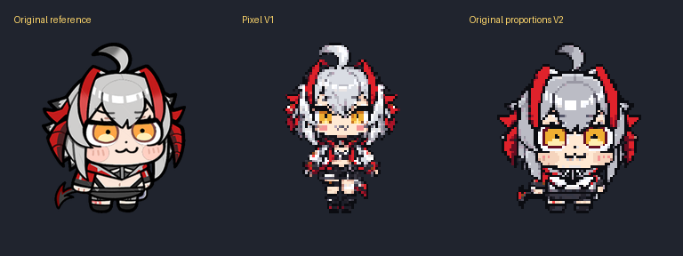
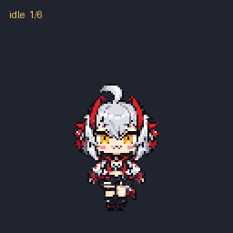
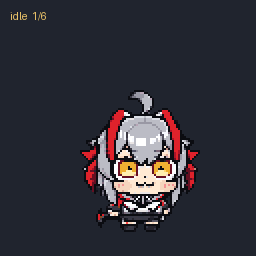

# codex-pet-wisdel(维什戴尔 Codex 桌面宠物)

维什戴尔 Codex 桌面宠物。原版使用维什戴尔「绝对主角」解包素材制作，另提供两个像素版本。

## 版本与下载

| 版本 | 特点 | 文件 / 安装包 |
| --- | --- | --- |
| 原版 | 原项目中的维什戴尔宠物 | [原版文件](wisadel/) |
| 维什戴尔·像素重制版 | 银发金瞳的像素重制，重新设计呼吸、迈步、挥手、跳跃与状态动画 | [版本说明](wisdel-pixel-remake/README.md) · [下载 ZIP](https://github.com/holy1ow/codex-pet-wisdel/raw/refs/heads/main/wisdel-pixel-remake/wisdel-pixel-remake-install.zip) |
| 维什戴尔·原比例特色版 | 保留原图大头短身比例，融入 Interact 眯眼晃头与 Special 怒目张嘴颜艺 | [版本说明](wisdel-pixel-original/README.md) · [下载 ZIP](https://github.com/holy1ow/codex-pet-wisdel/raw/refs/heads/main/wisdel-pixel-original/wisdel-pixel-original-install.zip) |

### 外观对照

从左到右为原始参考、像素重制版、原比例特色版。



### 动画预览

**维什戴尔·像素重制版**



**维什戴尔·原比例特色版**



## 安装

1. 下载所需版本的 ZIP 安装包并解压。
2. 在 Codex 的 `pets` 目录中，新建对应版本文件夹：
   - 像素重制版：`wisdel-pixel-remake`
   - 原比例特色版：`wisdel-pixel-original`
3. 将解压得到的 `pet.json` 和 `spritesheet.webp` 放入对应文件夹，两者保持同级。
4. 打开「设置 → 宠物」，点击「刷新」，选择对应名称即可使用。参见 [官方宠物使用说明](https://learn.chatgpt.com/docs/pets)。

默认安装目录：

| 系统 | 目录 |
| --- | --- |
| Windows | `%USERPROFILE%\.codex\pets` |
| macOS / Linux | `~/.codex/pets` |

如果设置了 `CODEX_HOME`，使用该目录下的 `pets` 文件夹。

安装后的结构：

```text
.codex/pets/
├── wisdel-pixel-remake/
│   ├── pet.json
│   └── spritesheet.webp
└── wisdel-pixel-original/
    ├── pet.json
    └── spritesheet.webp
```

安装包附带 PNG 副本和简要说明；实际安装使用 `pet.json` 与 `spritesheet.webp`。

## 像素版本规格

两种像素安装包均使用 Codex v2 格式，并已通过本机格式校验：

- `spriteVersionNumber: 2`。
- 精灵图尺寸 `1536 × 2288`，8 列 × 11 行，单格 `192 × 208`。
- 逻辑像素帧 `96 × 104`，整数 2 倍显示，32 色、二值透明通道、无损 WebP。
- 9 种状态动画与 16 向注视，共 73 个动画 / 注视帧。
- 第 0 行第 7 格另有一张静止回退图，供客户端回退使用；共 74 个有内容的格子，其余 14 格完全透明。

安装包里的精灵图与本机已安装版本一致，包含静止回退格。原比例特色版保留了原模型动作中的表情和姿态特征，并加强了动作可读性。
